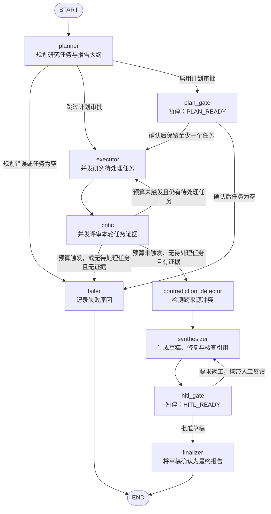

# Research Agent

基于 Python、LangGraph 和多角色大语言模型的研究助手。

项目将研究问题拆解为子任务，检索资料、提取证据、检查引用与冲突，
生成 Markdown 草稿，并通过人工审批形成最终报告。

当前目录主要包含独立研究引擎、本地 CLI、评估程序和测试。

## 功能

- Planner、Executor、Critic、Synthesizer 多角色协作。
- Web 检索与 PDF、Markdown、TXT 本地语料检索。
- 可选的研究计划审批，以及报告审批和返工。
- SQLite checkpoint 与审批门恢复。
- 证据、来源、矛盾信息检查。
- Markdown 报告及自包含 JSON bundle 导出。
- 离线 bundle 完整性校验。
- 确定性 Fake 模式及研究质量评估工具。

## Agent 图与节点编排

研究流程由 LangGraph 的 `StateGraph(AgentState)` 编排，入口是
`backend/research_engine/graph.py` 中的 `build_graph(checkpointer)`。
图包含 9 个业务节点，节点返回的状态更新会合并到同一个 `AgentState`，
条件路由函数根据更新后的状态选择下一步。

引擎默认 `skip_plan_gate=True`，本地 CLI 通过 `--plan-gate` 显式启用计划审批。

这里有两层执行结构：图负责规划、研究轮次、评审、合成和人工审批；
`executor` 节点内部负责并发研究多个子任务，以及每个任务的模型与工具调用循环。
因此，多个任务可以同时检索，但每一轮都要等待本轮任务结束后，才整体进入 Critic 评审。

### 整体流程图

下面的 Mermaid 图对应当前 `build_graph()` 注册的节点与边。
`START` 和 `END` 是 LangGraph 的虚拟起止点；箭头上的文字表示条件分支。
两个审批节点会暂停执行，待用户提交决定后才沿后续箭头继续。



### 九个节点分别做什么

| 节点 | 使用的模型角色 | 核心职责 | 主要写入状态 |
| --- | --- | --- | --- |
| `planner` | `planner` | 将问题拆成独立研究任务，生成拟定大纲；结构化输出无效时尝试重试，仍失败则记录错误。 | `tasks`、`proposed_outline`、研究轮次及证据状态的初始值 |
| `plan_gate` | 无 | 在检索前暂停，接收人工修改的任务和大纲，过滤 `include=false` 的任务。 | `tasks`、`proposed_outline`、`plan_approved` |
| `executor` | `executor` | 并发研究待处理任务，调用检索、读取和计算工具，提交结构化证据，并合并本轮结果。 | `evidence`、`research_round`、`sources_seen` |
| `critic` | `critic` | 按任务评审证据，记录通过与否、理由和补充检索建议；无效评审输出按不通过处理。 | `verdicts`、`retries` |
| `contradiction_detector` | `critic` | 按来源汇总证据，识别跨来源冲突并记录双方观点，供报告展示与人工判断。 | `contradictions` |
| `synthesizer` | `synthesizer`；引用核查使用 `critic` | 给来源编号，使用证据片段及大纲生成草稿，执行引用修复和支持性检查，插入冲突区块。 | `draft_report`、`sources`，并清空已使用的 `human_feedback` |
| `hitl_gate` | 无 | 暂停等待报告审批；批准则定稿，拒绝则保存反馈并增加返工次数。 | `approved`、`human_feedback`、`rework_count` |
| `finalizer` | 无 | 将当前 `draft_report` 写入 `final_report`，不再调用模型。 | `final_report` |
| `failer` | 无 | 根据规划错误、预算和证据状态生成可解释的失败原因。 | `error` |

调用模型的节点还会累计 `tokens_input`、`tokens_output` 和 `cost_usd`。
模型路由按角色配置，因此不同节点可以共用同一个模型，也可以分别使用不同提供商。
`contradiction_detector` 和引用核查复用 Critic 角色，没有额外的模型路由项；
`MODEL_CHAT` 用于独立对话能力，不属于这张研究图的节点。

### Executor 内部：工具调用与并发研究

`executor_node()` 先通过 `_pending()` 选出尚未通过评审、且失败次数尚未达到上限的任务，
再使用 `asyncio.Semaphore` 和 `asyncio.gather` 执行这些任务。
`MAX_PARALLEL_TASKS` 控制同时研究的任务数量，设为 1 时顺序执行。

每个任务由 `_research_one()` 完成以下过程：

1. 读取任务问题和上一轮 Critic 的反馈，为该任务创建独立的模型消息与工具观察记录。
2. 模型选择 `web_search`、`read_webpage`、`calculate` 等工具，工具结果通过
   `ToolMessage` 返回模型；同一批工具调用也可以并发执行。
3. 模型通过 `submit_evidence` 提交证据，包括来源 URL、来源标题、原文片段和关键事实。
   如果在工具轮次结束后仍未提交，代码会尝试强制提取已有资料中的证据。
4. 真实模式会将提交的引文与工具实际返回的文本比对，处理无法匹配或来源标错的片段，
   并给证据附上 `task_id`。Fake 模式目前跳过这一步原文核对。
5. 等待本轮任务完成，按任务定义顺序合并证据。重试任务以新结果替换该任务的旧证据，
   已通过或已耗尽重试次数的任务保留原结果，避免并发完成顺序改变引用编号。

Web 和 Corpus 使用同一张图。Web 模式下，检索依次尝试 Tavily、Brave、DuckDuckGo；
Corpus 模式下，搜索委托给本地语料库，`read_webpage` 读取 `corpus://` 文档位置。
数据源切换发生在工具和检索适配层，不需要增加另一套图节点。

研究深度还会影响每个任务的一次研究尝试：

| 深度 | 模型工具循环上限 | 页面读取数量阈值 |
| --- | --- | --- |
| `fast` | 3 轮 | 3 |
| `balanced` | 5 轮 | 5 |
| `comprehensive` | 8 轮 | 8 |

这些值来自 `_DEPTH_LIMITS`，用于判断何时停止继续阅读并进入证据提取。
页面阈值在下一轮开始前检查，同一批并发读取可能跨过该阈值，
因此它不是严格限制每次网络请求数量的硬上限。

### 条件路由与两种返工循环

图中的路径由四个条件路由函数控制：

| 路由函数 | 判断规则 |
| --- | --- |
| `route_after_planner()` | 有规划错误或没有任务时进入 `failer`；否则根据 `skip_plan_gate` 进入 `executor` 或 `plan_gate`。 |
| `route_after_plan_gate()` | 人工编辑后仍有任务则开始研究；没有任务则进入 `failer`。 |
| `route_after_critic()` | 先检查预算，再检查是否还有待处理任务；需要重试则返回 `executor`，全部处理完但证据为空则失败，否则进入冲突检测。 |
| `route_after_gate()` | 报告获批则进入 `finalizer`；要求返工则返回 `synthesizer`。 |

**研究重试循环：`executor → critic → executor`。**
只重新研究未通过且未耗尽次数的任务，下一次研究会读取 Critic 的补充建议。
`MAX_CRITIC_LOOPS` 按每个任务累计的不通过次数生效，首次不通过也计数。
例如设为 2 时，持续不通过的任务最多执行两轮研究与评审，而不是首次研究后再重试两次。

任务通过评审或耗尽次数后，都会离开待处理集合。
因此，进入报告合成并不表示全部任务都通过了 Critic：
只要预算未触发、没有待处理任务且总证据非空，图仍会继续使用已有证据。
所有任务最终都没有提供证据时，图进入 `failer`，不会生成无证据报告。
这里的“有证据”对应 `evidence` 列表非空，不代表每一条引文或结论都已通过真实性认证。

**报告返工循环：`synthesizer → hitl_gate → synthesizer`。**
用户拒绝草稿后，反馈写入 `human_feedback`，合成器使用现有证据重新生成报告。
该路径不会重新运行 Planner、Executor、Critic 或冲突检测；
即使反馈写着“补充来源”，当前返工路径也不会自动发起新检索。
新草稿完成后再次进入报告审批门，获批后才定稿。
图中没有为人工返工次数设置专门的业务上限，仍受 LangGraph 执行约束。

### 共享状态与暂停恢复

节点通过 `AgentState` 交换结果，而不是依靠模型之间直接对话：

| 状态分组 | 代表字段 | 用途 |
| --- | --- | --- |
| 研究输入 | `session_id`、`original_query`、`research_depth` | 标识会话、研究问题和深度。 |
| 研究计划 | `tasks`、`proposed_outline`、`plan_approved` | 保存任务和人工确认后的报告结构。 |
| 研究进度 | `evidence`、`verdicts`、`retries`、`research_round`、`sources_seen` | 保存证据、逐任务评审结果和研究轮次。 |
| 草稿与审批 | `draft_report`、`sources`、`contradictions`、`approved`、`human_feedback`、`rework_count` | 支持来源展示、冲突呈现和人工返工。 |
| 输出与统计 | `final_report`、`error`、`tokens_input`、`tokens_output`、`cost_usd`、`started_at` | 保存最终结果、错误和运行统计。 |

模型、密钥、缓存、语料库和事件接收器由宿主通过 `RunConfig` 及相关端口注入。
`runner.run()` 创建初始状态，以 `session_id` 作为 LangGraph 的 `thread_id` 启动图；
本地 CLI 使用 SQLite checkpointer 保存节点间状态。

`plan_gate` 和 `hitl_gate` 分别通过 `interrupt()` 发出 `PLAN_READY` 与 `HITL_READY`。
这两种暂停对应 `awaiting_plan`、`awaiting_approval`，属于等待人工输入的正常状态。
`runner.resume()` 使用相同的 `thread_id` 和 `Command(resume=...)` 提交计划编辑或审批决定，
从审批节点继续执行，不会从 Planner 重新开始。

预算检查也有明确位置：Critic 后的路由检查费用、累计输入 Token 和墙钟时间，
Executor 内部另有共享费用检查。它们没有覆盖每一次模型调用前的全部预算条件，
因此不能将这些配置理解为全流程的严格实时停止机制。

`finalizer` 只更新图状态；报告文件写入、事件日志、会话清单与 bundle 导出由 CLI 宿主处理。
显式失败分支由 `failer` 记录原因，未捕获的运行时异常仍需由调用方处理。

## 环境要求与安装

需要 Python 3.11 或更高版本。

以下命令从项目根目录开始，在 PowerShell 中执行：

```powershell
cd backend
py -3.11 -m venv .venv

.\.venv\Scripts\python.exe -m pip install -e "./research_engine[local,corpus]" python-dotenv
```

建议在新环境中安装依赖，避免依赖随项目复制的虚拟环境。

可选依赖：

| Extra | 用途 |
| --- | --- |
| `local` | CLI 的 SQLite checkpoint |
| `corpus` | 本地语料处理与向量计算 |
| `google` | Google 模型 |
| `anthropic` | Anthropic 模型 |
| `openai` | OpenAI，以及 Ollama、OpenRouter、custom 兼容接口 |

例如，安装 Google 模型支持：

```powershell
.\.venv\Scripts\python.exe -m pip install -e "./research_engine[google]"
```

查看命令帮助：

```powershell
.\.venv\Scripts\python.exe -m research_engine.cli --help
```

## 快速开始

使用 Fake 模式运行完整流程，不需要密钥或外部模型：

```powershell
.\.venv\Scripts\python.exe -m research_engine.cli "大语言模型为什么会产生幻觉？" --fake --yes --data-dir "./output/demo-data" --output "./output/demo.md"
```

`--yes` 自动批准报告审批门，适合演示。

Fake 模式用于验证流程、存储与输出格式，不能代表真实研究质量。

## 配置真实模型

所有示例均在 `backend` 目录中执行。

CLI 会尝试读取当前工作目录上一级的 `.env`。
自动读取需要安装 `python-dotenv`；进程环境变量优先于文件配置。

五个角色均使用 `provider:model` 格式：

```dotenv
MODEL_PLANNER=google:gemini-2.5-flash
MODEL_EXECUTOR=google:gemini-2.5-flash
MODEL_CRITIC=google:gemini-2.5-flash
MODEL_SYNTHESIZER=google:gemini-2.5-flash
MODEL_CHAT=google:gemini-2.5-flash

GOOGLE_API_KEY=your-key
```

也可配置：

- `ANTHROPIC_API_KEY`
- `OPENAI_API_KEY`
- `OPENROUTER_API_KEY`
- `CUSTOM_API_KEY` 与 `CUSTOM_BASE_URL`
- `OLLAMA_BASE_URL`，默认 `http://localhost:11434/v1`

Ollama、OpenRouter 和 custom 路由需要安装 `openai` extra。

CLI 通过 `--fake` 选择模拟模式。
仅设置 `LLM_MODE=fake` 不会让 CLI 自动使用 Fake。

真实研究示例：

```powershell
.\.venv\Scripts\python.exe -m research_engine.cli "比较不同 Agent 评估方法" --depth balanced --data-dir "./output/data" --output "./output/report.md"
```

研究深度支持 `fast`、`balanced`、`comprehensive`。

## 人工审批

### 研究计划审批

```powershell
.\.venv\Scripts\python.exe -m research_engine.cli "研究问题" --plan-gate --data-dir "./output/data"
```

程序生成会话 ID 和可编辑计划文件，然后暂停。

直接批准原计划：

```powershell
.\.venv\Scripts\python.exe -m research_engine.cli --resume-plan SESSION_ID --data-dir "./output/data"
```

提交编辑后的计划：

```powershell
.\.venv\Scripts\python.exe -m research_engine.cli --resume-plan SESSION_ID --plan-file "./output/data/plans/SESSION_ID.json" --data-dir "./output/data"
```

计划可修改任务问题、子主题和报告大纲；
设置 `include=false` 可排除任务，至少保留一个任务。

`--yes` 不能与 `--plan-gate` 同时使用。

### 报告审批

导出待审草稿：

```powershell
.\.venv\Scripts\python.exe -m research_engine.cli --export-draft SESSION_ID --output "./output/draft.md" --data-dir "./output/data"
```

检查证据、来源与冲突：

```powershell
.\.venv\Scripts\python.exe -m research_engine.cli --inspect SESSION_ID --show all --json --data-dir "./output/data"
```

要求返工：

```powershell
.\.venv\Scripts\python.exe -m research_engine.cli --reject SESSION_ID --feedback "补充一手资料并说明研究限制" --data-dir "./output/data"
```

批准报告：

```powershell
.\.venv\Scripts\python.exe -m research_engine.cli --approve SESSION_ID --data-dir "./output/data"
```

启动时指定的最终输出路径会保存在会话清单中，批准后写入报告。

恢复命令必须使用原来的 `--data-dir`，并保持原模型路由。
当前 CLI 支持恢复两个审批门，没有通用的任意崩溃点 `--resume` 命令。

## 本地知识库

真实语料检索需要可用的嵌入服务，默认使用本机 Ollama
和 `nomic-embed-text` 模型。

```powershell
ollama pull nomic-embed-text

.\.venv\Scripts\python.exe -m research_engine.cli --ingest "./notes.md" --data-dir "./output/data"
.\.venv\Scripts\python.exe -m research_engine.cli --list-corpus --data-dir "./output/data"
.\.venv\Scripts\python.exe -m research_engine.cli --corpus-status --data-dir "./output/data"
```

`--ingest` 可重复传入，支持 PDF、Markdown 和 TXT。

基于语料研究：

```powershell
.\.venv\Scripts\python.exe -m research_engine.cli "总结上传资料的核心观点" --source corpus --data-dir "./output/data"
```

删除文档：

```powershell
.\.venv\Scripts\python.exe -m research_engine.cli --delete-document DOCUMENT_ID --data-dir "./output/data"
```

可通过 `--corpus-db` 指定语料数据库，通过以下选项指定嵌入配置：

- `--embedding-model`
- `--embedding-base-url`
- `--embedding-dimensions`

导入和研究应使用一致的数据库与嵌入配置。

当前 Corpus 模式封锁 Web 检索与网页读取，但没有限制研究模型必须本地运行。
使用托管模型时，检索出的文档片段仍会发送给模型提供商。
需要全部本地处理时，应另外将所有角色模型和嵌入端点配置为本机服务。

## 导出报告与 Bundle

重新导出已完成的报告，不重新研究：

```powershell
.\.venv\Scripts\python.exe -m research_engine.cli --export SESSION_ID --output "./output/report-copy.md" --data-dir "./output/data"
```

导出包含报告、证据、来源、审批链和可用事件轨迹的 bundle：

```powershell
.\.venv\Scripts\python.exe -m research_engine.cli --export-bundle SESSION_ID --bundle-output "./output/report.bundle.json" --data-dir "./output/data"
```

离线验证：

```powershell
.\.venv\Scripts\python.exe -m research_engine.cli --verify-bundle "./output/report.bundle.json"
```

正式 bundle 要求会话已完成，并具有本地报告审批记录。
完整性校验用于检查结构、哈希和引用关联，不等同于结论真实性认证。

输出文件默认不覆盖；需要覆盖时显式添加 `--overwrite-output`。

## 状态与配置

默认状态目录为 `~/.research-engine`：

```text
.research-engine/
├── checkpoints.sqlite
├── cache.sqlite
├── corpus.sqlite
├── plans/
└── sessions/
```

使用 `--data-dir` 可指定其他目录。
会话清单保存恢复所需配置，不保存提供商密钥。

常用配置：

| 配置 | 用途 |
| --- | --- |
| `TAVILY_API_KEY`、`BRAVE_API_KEY` | 搜索服务 |
| `MAX_PARALLEL_TASKS` | 研究任务并发数，默认 4 |
| `MAX_CRITIC_LOOPS` | Critic 重试控制，默认 2 |
| `RETRIEVAL_K` | 默认检索数量，默认 5 |
| `MIN_SOURCES_PER_TASK` | 每个任务的来源数量要求 |
| `MAX_COST_PER_SESSION_USD` | 按记录成本检查费用预算 |
| `MAX_WALLCLOCK_SECONDS` | 墙钟时间预算 |
| `MAX_INPUT_TOKENS` | 输入 Token 预算 |
| `MAX_OUTPUT_TOKENS_<ROLE>` | 各角色输出 Token 上限 |
| `CORPUS_EMBEDDINGS_MODEL` | 本地语料嵌入模型 |

费用、墙钟时间和总输入 Token 预算默认值为 0，表示不限制。

当前 CLI 对未知模型的定价校验存在缺口；
部分路由报告的零成本不代表实际免费，费用预算也不是严格的计费上限。

添加 `--event-log "./output/events.jsonl"` 可保存事件日志；
`--verbose` 显示事件详情，`--json` 输出结构化结果。

## 目录结构

```text
research-agent/
├── README.md
├── .env.example
├── .gitignore
└── backend/
    ├── research_engine/
    │   ├── cli.py
    │   ├── runner.py
    │   ├── graph.py
    │   ├── runconfig.py
    │   ├── llm_factory.py
    │   ├── tools.py
    │   ├── retrievers.py
    │   ├── corpus.py
    │   ├── bundle.py
    │   ├── verify_bundle.py
    │   └── pyproject.toml
    ├── evals/
    ├── tests/
    └── output/
```

## 测试与评估

当前快照的测试入口无条件依赖 `app.runtime`，但未包含 `app` 包，
因此直接运行完整 pytest 会在加载测试配置时失败。
部分服务端测试还需要 PostgreSQL、pgvector 等配套环境。

独立评估命令在 `backend` 目录中执行：

```powershell
# Fake 管线检查；会生成评估结果文件
$env:LLM_MODE = "fake"
.\.venv\Scripts\python.exe -m evals.harness --limit 1
.\.venv\Scripts\python.exe -m evals.contradiction_eval

# 真实研究评估；会调用外部模型和检索服务
$env:LLM_MODE = "real"
.\.venv\Scripts\python.exe -m evals.harness --limit 1

# 本地检索质量评估；需要真实嵌入服务
.\.venv\Scripts\python.exe -m evals.retrieval
```

评估程序在读取 `.env` 之前确定 `LLM_MODE`，
因此应在当前进程中显式设置真实模式。

Fake 结果只用于验证管线。
真实质量应结合完成率、引用支持率、未引用断言、检索质量、耗时和成本判断。
`null` 或 `UNMEASURED` 表示未测得，不能视为通过。
